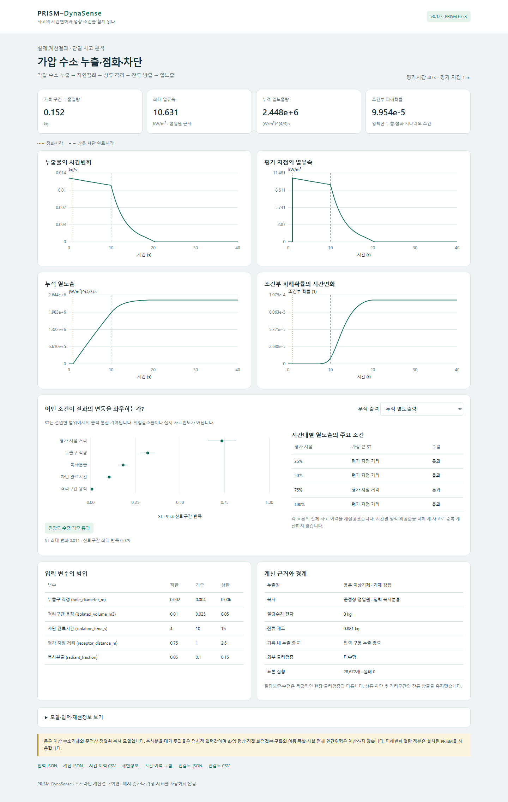

# PRISM-DynaSense

**Understand how an accident evolves, and which uncertain conditions drive its consequences.**

PRISM-DynaSense is a small, local research application combining an event-driven release model, the installed [PRISM](https://github.com/lyullee/prism) thermal-dose/probit functions, and [SALib](https://salib.readthedocs.io/) Sobol sensitivity analysis. It exports an interactive offline dashboard, reproducible input/output files, and PNG/SVG figures.

[Korean overview](README_ko.md) · [User manual (Korean)](docs/USER_MANUAL_KO.md) · [Model and architecture](docs/ARCHITECTURE.md) · [Registration preparation (Korean)](docs/REGISTRATION_KO.md)



## What version 0.1.0 actually calculates

The implemented scenario is **pressurized hydrogen gas release → delayed ignition → upstream isolation → continued downstream residual release → thermal exposure**. Pressure and inventory evolve with time. Every sensitivity sample re-executes that model, including the events and the PRISM dose conversion.

- Ideal, isothermal hydrogen gas, 250–350 K and initial absolute pressure above atmospheric up to 5 MPa.
- Choked/subcritical nozzle outflow; finite upstream and isolated downstream volumes.
- Explicit ignition/isolation times and finite assessment horizon.
- Quasi-steady **point-source radiation**, with explicitly supplied radiant fraction and transmissivity.
- Installed `prism-risk==0.6.8` for thermal dose and thermal probit conversion; backend module hashes recorded.
- Global S1/ST indices, bootstrap intervals, multi-level convergence gates, one-at-a-time endpoint comparisons, and eight outputs including three time checkpoints.

This release has **one physical scenario and one supported substance**. It does not implement a generic chemical-property engine, transient dispersion, full flame geometry, direct flame contact, explosion, process simulation, real-time sensor ingestion, or annual facility risk. The architecture permits future adapters; that is not a claim that those adapters already exist. Numerical tests and Sobol convergence do not establish independent experimental validation. The illustrative near-field point-source results must not be used as a safe-separation-distance determination.

## Install and run

Python 3.12+ is required. Download the wheel from [Releases](https://github.com/lyullee/prism-dynasense/releases), then:

```console
python -m pip install prism_dynasense-0.1.0-py3-none-any.whl
prism-dynasense doctor
prism-dynasense demo --out result --open
```

Dependencies are installed from PyPI. PRISM-DynaSense itself is not claimed to be published on PyPI.

From a checkout:

```console
python -m pip install -e ".[test,build]"
prism-dynasense template input.json
prism-dynasense run input.json --out baseline
prism-dynasense sensitivity input.json --out study --levels 128 256 512
python -m pytest -q
python -m build
python -m twine check dist/*
```

Open `result/report.html` in a browser. The result is a **readable dashboard**, not an interactive input editor or server; change the input JSON and rerun the CLI to calculate a new case. All computation is local. The dashboard has no CDN, telemetry, or external assets.

## Read the results correctly

| Output | Meaning |
|---|---|
| Released mass | Material released during the specified observation window |
| Peak release rate | Maximum source rate, including any pre-ignition release |
| Peak heat flux | Maximum post-ignition point-source heat flux at the receptor |
| Thermal dose | Integral of heat flux to the power 4/3 over exposure time |
| Conditional harm probability | PRISM thermal-probit transformation, conditional on the specified accident and exposure |
| Dose at 25%, 50%, 75% | Dose accumulated at fractions of the specified assessment horizon |

`ST` measures output-variance sensitivity **within the declared independent uniform input ranges**. It is not an accident probability, reduction percentage, or universal equipment ranking. Percentiles describe these input assumptions, not a measured population of facilities. The convergence gate requires maximum ST change ≤0.05, maximum bootstrap 95% interval half-width ≤0.10, and stable top-three membership across the final two sample levels. An index is withheld if the calculation fails or the output has no variance. Gate thresholds are software screening choices, not regulatory acceptance limits.

For D inputs and base size N, the first/total-order design has **N(D+2) rows**. N=512 with five inputs means 3,584 rows, not 512 accident scenarios. Nested designs reuse identical cases only; no surrogate is substituted. Default demo levels 64/128/256 are a quick preview and can remain unconverged.

## Reproducible example

`examples/hydrogen_segment.json` contains synthetic, project-authored demonstration inputs. `examples/results/hydrogen/` contains real calculated results. See [the recorded validation and example summary](docs/VALIDATION.md) for actual sample counts, convergence and checks. Raw samples, histories, local sensitivity, input hashes, dependency versions and backend hashes are exported together.

## Ownership and dependencies

The newly written orchestration, input contracts, event/source model, convergence policy, exports and dashboard are separated from PRISM and SALib dependencies. External implementations are **not** repackaged as original code. See [THIRD_PARTY_NOTICES.md](THIRD_PARTY_NOTICES.md).

Distributed under MIT. A copyright-registration preparation archive identifies original source files, fingerprints, documentation, and unresolved legal ownership fields; it is not a registration certificate. Repository maintainer identity does not establish employment-related or organizational ownership. The release is an alpha research tool.
