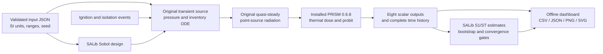

# Model and architecture

## Calculation graph

SALib generates independent uniform samples. The source model and PRISM are run for each distinct sample. PRISM is not used as a label on a precomputed or fictitious result. No legacy ammonia research results are imported.

## State, events, and equations

All pressure values are absolute. Ideal hydrogen: R=8.31446261815324/0.00201588 J/(kg K), gamma=1.4, LHV=120 MJ/kg, atmospheric pressure=101,325 Pa. These are declared modeling constants, not a temperature-dependent property database. The ideal-gas and isothermal approximations can be inadequate near the allowed envelope boundaries.

For fixed volume V and constant T: `m=PV/(RT)` and `dP/dt=-(RT/V) m_dot(P)`. A standard isentropic ideal-gas nozzle formula handles the choked/subcritical pressure-ratio branches. SciPy `solve_ivp` integrates pressure (rtol=1e-8, atol=1e-4 Pa) with atmospheric-pressure termination. The leak stops at atmospheric pressure; inventory remains.

Before isolation, V is the sum of upstream and downstream volumes. At isolation, pressure is continuous, upstream mass is retained separately, and only the downstream volume supplies the remaining release. The upstream supply is a finite connected volume, not a fixed-pressure infinite source. Valve closure is instantaneous at the stated completion time; valve stroke curves are not modeled. There is no inflow after the initial inventory.

After the stated ignition time, `q_rad(t)=chi * LHV * m_dot(t) * tau/(4*pi*r²)`. Before ignition heat flux is zero. The source is a point with fixed receptor distance. No flash fire from pre-ignition inventory, flame geometry, shielding, plume transport, unburned-fuel accumulation, weather-dependent transmissivity, or direct flame impingement is modeled. Low flow is assumed to sustain combustion in this screening equation; extinction physics is not resolved.

The thermal dose is `D(t)=integral q_rad(t)^(4/3) dt`. Linear-flux segments are integrated analytically. Ignition is an event boundary: there is no artificial pre-ignition triangular ramp. Final dose is checked against installed `lh2_tno.risk.thermal_dose`; the cumulative integrator uses the same physical interpolation assumption and is not an independent experimental validation. `prism_qra.risk.ThermalProbit` gives `Pr=-36.38+2.56*ln(D)`; installed `probit_to_probability` converts this using the conventional probit mean 5. This is conditional thermal mortality-type screening for the stated unprotected exposure, not incident frequency or annual individual risk. Exact zero dose maps to zero. Extremely small probabilities can round to zero in PRISM's double-precision implementation.

Recorded outputs cover a **finite horizon**. If source pressure remains above ambient at the end, later exposure is explicitly not claimed. Dose checkpoints are fractions of that horizon, not fractions of total lifetime exposure.

## Application modules and originality boundary

| Module | Responsibility | Boundary |
|---|---|---|
| contracts.py | Input schema, units through named SI fields, feasible range endpoints | Original application logic; Pydantic dependency |
| simulation.py | Event segmentation, connected/isolated inventory, source ODE orchestration, radiation, histories | Original implementation of established equations; SciPy solver dependency |
| prism_backend.py | Public PRISM function calls, exact version gate, module fingerprints | Adapter original; PRISM equations/implementation third party |
| sensitivity.py | Experiment orchestration, exact sample cache, missing-result handling, multi-level gates, local endpoints | Original workflow; SALib estimators third party |
| io.py | Strict JSON, CSV, input/code/dependency fingerprints | Original |
| report.py and templates/dashboard.html | Korean self-contained dashboard and figure/export integration | Original; Matplotlib dependency |
| cli.py | Commands, validated workflow, return codes | Original |

The reusable parts are orchestration, contracts, output handling and visualization. Adding another substance or hazard requires a separately validated physical adapter and appropriate output contracts. This release deliberately rejects unsupported fluid names. There is no unsafe generic fallback.

## Sensitivity and uncertainty

The scrambled Sobol/Saltelli design uses N(D+2) rows with second-order estimation disabled. SALib computes S1/ST and 300 bootstrap resamples by default. Identical rows across levels reuse exactly matching direct-model outputs; no approximate surrogate or interpolation is used. Output percentiles are uniform-input study summaries, not empirical facility statistics. Input correlation and epistemic model uncertainty are not represented.

Failure never becomes zero. A nonfinite evaluation withholds the affected output's indices across that design, because individual row removal breaks Saltelli ordering. Constant output has undefined variance sensitivity. All-input ST change, all-input CI half-width and top-three membership are recorded separately from the convergence decision. The last two levels determine the gate; passing multiple levels does not establish global physical accuracy.

## Sources

- [PRISM public repository and license](https://github.com/lyullee/prism): installed 0.6.8 thermal dose and probit APIs.
- [SALib official API documentation](https://salib.readthedocs.io/en/latest/api.html): Sobol design and first/total-order estimation.
- [SciPy solve_ivp documentation](https://docs.scipy.org/doc/scipy/reference/generated/scipy.integrate.solve_ivp.html): adaptive initial-value solver used for the declared ODE.
- [NASA Glenn compressible mass-flow derivation](https://www.grc.nasa.gov/www/k-12/airplane/mflchk.html): conventional compressible nozzle relations, independently implemented here.

Sources are linked for provenance. External website prose and figures are not redistributed.
